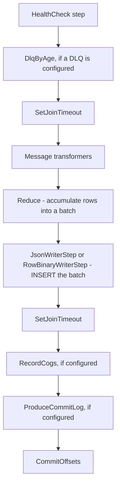

# rust-snuba consumers

Snuba has two ways to ingest data into clickhouse: The old, Python-based consumers, and this Rust consumer.

This document is about the Rust one, but due to it starting out as a
line-by-line port of the Python consumer, the higher-level architecture also
applies to Python.

## Entrypoint

`rust_snuba` is a library crate that is being compiled with PyO3/maturin into a
Python wheel. This Python wheel exposes a `consumer` function which is used
from within the Snuba (Python) CLI to launch `snuba rust-consumer`.
Configuration parsing, CLI parsing and runtime config are still handled in
Python so as to avoid unnecessary code duplication and potentially multiple
sources of truth for config.

## Steps

`rust_snuba` uses the Rust port of Arroyo to define its own consumer. `ConsumerStrategyFactoryV2` in `src/factory_v2.rs` builds these processing strategies, in the order a message passes through them:

1. Healthcheck step, only with `--health-check-file`. `--health-check arroyo|commit-progress|partition-stall` picks the strategy. It touches a file to signal to Kubernetes that the consumer is alive. See [Healthchecks](../docs/source/architecture/consumer.rst).
2. `DlqByAge`, only when the storage has a DLQ. It sends a configurable share of too-old messages to the DLQ so a backlogged consumer can catch up.
3. `SetJoinTimeout`, set to `--join-timeout-ms`. During a rebalance, in-flight work in the next steps is dropped after this timeout instead of awaited. Dropping is safe for parsing and batching, which have no side effects.
4. Message transformers. A thread pool parses messages, validates them, and turns them into rows. Most datasets have a Rust-native processor. With `--use-python-processor`, or when no Rust processor exists, the step calls back into the Python `MessageProcessor`. Processors that emit replacements are followed by `ProduceReplacements`.
5. `Reduce` accumulates rows into one in-memory `BytesInsertBatch<RowData>`. `--max-batch-size` (rows, or bytes with `--max-batch-size-calculation=bytes`) and `--max-batch-time-ms` bound a batch. Empty batches are flushed too, so offsets still get committed.
6. The ClickHouse writer, `JsonWriterStep` or, with `--use-row-binary`, `RowBinaryWriterStep` (in `src/strategies/clickhouse/writer_v2.rs`). It sends each batch as one HTTP `INSERT` and waits for ClickHouse to respond. Up to `--clickhouse-concurrency` batches (default 2) are in flight at once.
7. `SetJoinTimeout` again, set to `--join-timeout-ms`, for the steps after the write.
8. `RecordCogs` produces COGS data to the accountant topic, and `ProduceCommitLog` produces to the commit log topic. Each runs only when configured. They are typically not relevant for performance.
9. `CommitOffsets` commits Kafka offsets every second.

## Batching

ClickHouse can only deal with a very low rate of inserts. You might have heard
it can only handle 1 INSERT/s, but that is more of a rule of thumb.

Since we have many consumer replicas inserting into each ClickHouse cluster, we
need to calculate each consumer's batch size and time according based on
replica count. For example, if we have 12 replicas, each consumer may only
insert once every 12 seconds (`--max-batch-time-ms=12000`), so that on average
there is one insert per second. In the ops repo this parameter is abstracted
away with `batch_time_per_replica`, which is typically 1000 (ms).

`Reduce` holds the whole batch in consumer memory. The writer step lz4-compresses the encoded rows and sends them in one HTTP request, retrying according to the ClickHouse write retry policy in `src/options.rs`. Size `--max-batch-size` and `--clickhouse-concurrency` so that the in-flight batches fit in memory.

